# Enterprise Agentic RAG

An agentic Retrieval-Augmented Generation system that answers technical questions about **Kubernetes, Intel hardware and enterprise networking** from a private document corpus. It is built with **LangGraph**, **Qdrant**, **Gemini embeddings**, **FlashRank**, **Groq (Llama 3.3)** behind the **Portkey** gateway, and **NeMo Guardrails**, and it is measured with **RAGAS**.

The corpus deliberately mixes 6 relevant "true" documents with 58 unrelated "noisy" files (papers, books, slides). The system has to find the right passages without being told which documents are noise.

---

## Table of Contents

1. [What happens when you ask a question](#1-what-happens-when-you-ask-a-question)
2. [System architecture](#2-system-architecture)
3. [The agent graph](#3-the-agent-graph)
4. [Guardrails: the first gate](#4-guardrails-the-first-gate)
5. [Ingestion: from files to vectors](#5-ingestion-from-files-to-vectors)
6. [How the chunker splits text](#6-how-the-chunker-splits-text)
7. [Two-stage retrieval](#7-two-stage-retrieval)
8. [The LLM gateway](#8-the-llm-gateway)
9. [Conversation memory](#9-conversation-memory)
10. [Evaluation](#10-evaluation)
11. [Observability](#11-observability)
12. [Project structure](#12-project-structure)
13. [Getting started](#13-getting-started)
14. [Changelog](#14-changelog)
15. [Known limitations](#15-known-limitations)
16. [Documentation index](#16-documentation-index)

---

## 1. What happens when you ask a question

The sequence below follows one technical question from the chat box to the answer. A conversational message (for example "what did I just ask?") follows the same path but skips the retrieval steps.

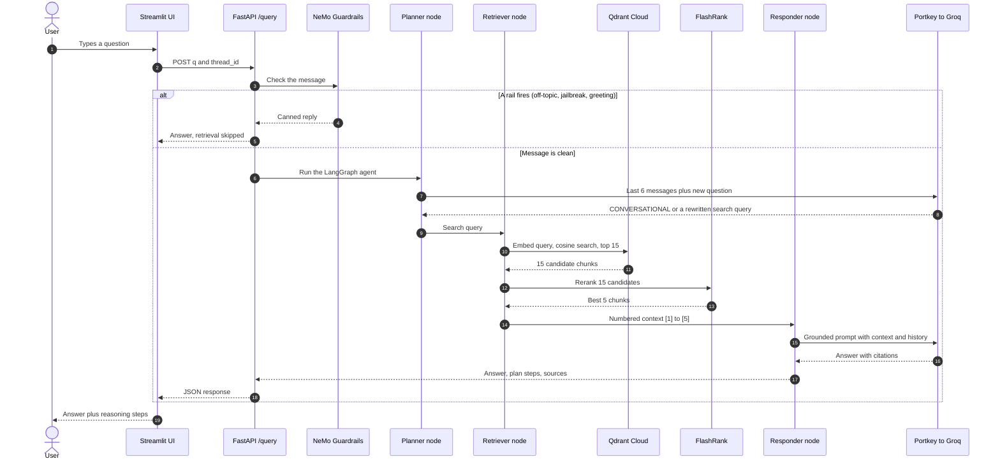

In plain words:

- **Guardrails decide if the question is allowed.** Jailbreaks and off-topic requests are answered with a fixed reply and never reach the expensive part of the pipeline.
- **The planner decides if documents are needed.** Greetings and memory questions are answered straight from the conversation. Technical questions are rewritten into a standalone search query, so a follow-up like "and what about its limits?" still finds the right documents.
- **Retrieval runs in two stages.** A fast vector search collects 15 candidates, then a more accurate cross-encoder keeps the best 5.
- **The responder answers only from the retrieved passages**, cites them as [1], [2] and so on, and says it could not find the answer when the passages do not contain it.

---

## 2. System architecture

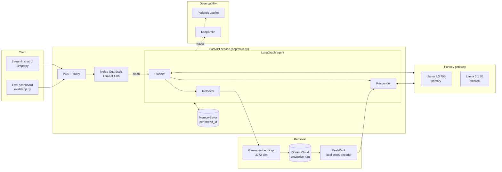

| Layer | Technology | Why it was chosen |
|-------|-----------|-------------------|
| Orchestration | LangChain + LangGraph | Typed state, conditional edges and built-in checkpointing for memory |
| LLMs | Groq Llama 3.3 70B, fallback Llama 3.1 8B | Very low latency inference |
| Gateway | Portkey | Retries, model fallback, caching and per-feature metadata in one place |
| Guardrails | NeMo Guardrails (Colang) | Declarative intent flows that block unsafe input before retrieval |
| Embeddings | Gemini `gemini-embedding-2-preview` (3072-dim) | Strong retrieval quality; local `all-mpnet-base-v2` fallback |
| Vector DB | Qdrant Cloud | Managed HNSW index with payload filtering |
| Reranking | FlashRank (ONNX MiniLM cross-encoder) | Runs locally, so reranking costs no API calls |
| Parsing | pypdf, pdfplumber, BeautifulSoup, Unstructured | Everything is parsed on the machine; no external OCR service |
| Observability | Pydantic Logfire + LangSmith | Nested spans for every node, plus prompt-level traces |
| Evaluation | RAGAS + custom Tool Correctness | Six metrics: five from RAGAS and one Jaccard routing check |

---

## 3. The agent graph

The agent is a small LangGraph state machine. Every node reads the shared `AgentState` and returns only the fields it changes.

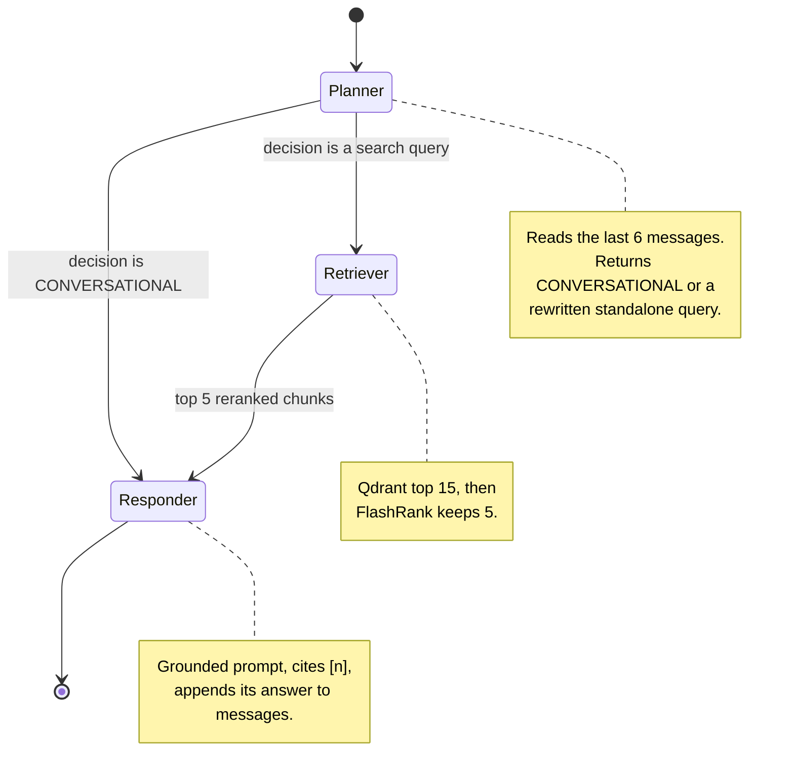

**The shared state** (`app/agents/state.py`):

| Field | Meaning | How it updates |
|-------|---------|----------------|
| `messages` | Full conversation for this thread | Appended to, thanks to the `operator.add` reducer |
| `current_query` | `CONVERSATIONAL` or the rewritten search query | Set by the planner |
| `documents` | Retrieved and reranked chunks | Replaced each turn |
| `plan` | Human-readable steps shown in the UI | Replaced each turn |
| `status` | Short status string | Replaced each turn |
| `final_answer` | The answer returned to the user | Set by the responder |

**Why this is "agentic":** an LLM chooses the control flow (retrieve or answer from memory) and writes the search query itself. The action space is limited to two branches on purpose. A bounded router is cheaper, faster and much easier to evaluate than an open-ended tool loop.

**Robust routing:** LLMs rarely follow "output ONLY X" exactly. `is_conversational()` strips quotes, punctuation and case before comparing, so `"CONVERSATIONAL."` or `'conversational'` no longer gets sent to Qdrant as a search query.

---

## 4. Guardrails: the first gate

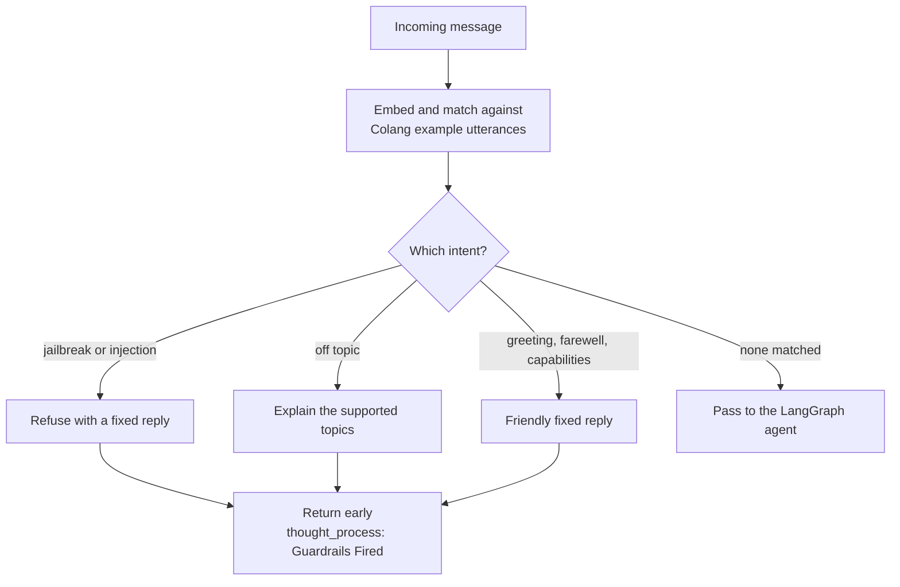

- Intents and responses are defined in `app/guardrails/colang_rules.py`.
- Classification uses the small, fast `llama-3.1-8b-instant` model. The 70B model is kept for the RAG answer.
- A blocked message never reaches retrieval, so adversarial text stays out of the main prompt and costs nothing extra.
- The API detects a fired rail by matching distinctive phrases from the canned replies (`RAIL_INDICATORS`).

---

## 5. Ingestion: from files to vectors

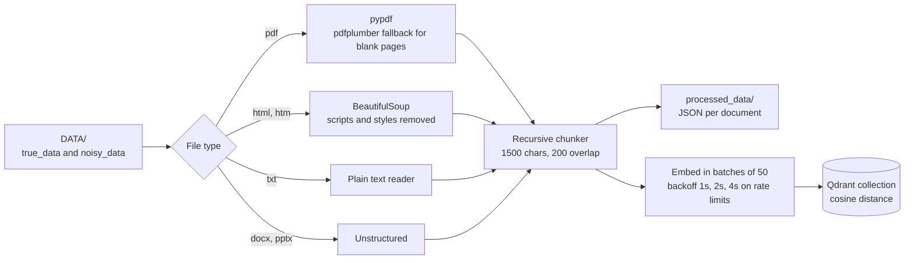

Run it with:

```powershell
python -m app.ingestion.processor DATA --wipe
```

- Each sub-folder becomes a `source_type` (`true`, `noisy` or the folder name), stored in the payload with the chunk text and file name.
- `--wipe` drops and recreates the collection. Without it, new points are appended.
- The collection dimension is chosen at creation time from the active embedding model: 3072 for Gemini, 768 for the local fallback.
- PDF pages recovered by pdfplumber are kept in their original reading order, and pages are separated by a blank line so the chunker sees a paragraph boundary.

---

## 6. How the chunker splits text

PDF and HTML loaders mostly emit single line breaks. The old chunker only split on blank lines, so whole documents became one chunk of up to 62,725 characters. The current splitter in `app/ingestion/chunking/splitter.py` is recursive.

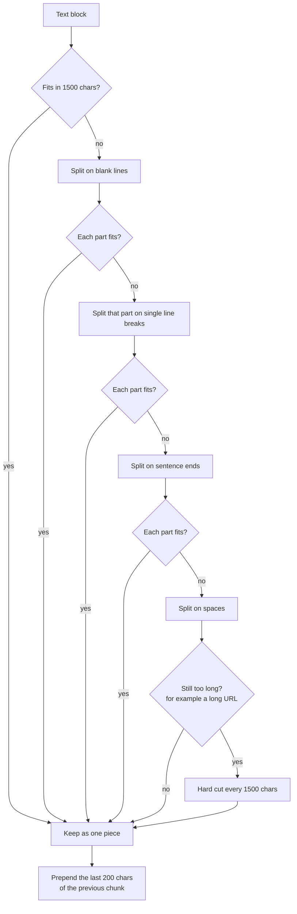

The 200-character overlap means a fact that sits across a chunk boundary still appears whole in at least one chunk.

**Measured on the sample corpus:**

| Document | Chunks before | Largest before | Chunks after | Largest after |
|----------|--------------:|---------------:|-------------:|--------------:|
| Intel 5-Level Paging rev 1.1 (PDF) | 1 | 62,725 | 43 | 1,696 |
| Intel 5-Level Paging rev 1.0 (PDF) | 1 | 58,403 | 40 | 1,692 |
| 37 Million Compilations (PDF) | 1 | 25,049 | 17 | 1,692 |
| pods_autoscale.html | 1 | 17,731 | 13 | 1,695 |
| job_management.html | 1 | 8,951 | 7 | 1,692 |
| **All 11 processed documents** | **80** | **62,725** | **189** | **1,697** |

---

## 7. Two-stage retrieval

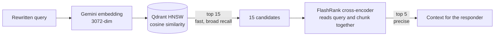

| Stage | Model type | Strength | Weakness |
|-------|-----------|----------|----------|
| Vector search | Bi-encoder: query and document embedded separately | Very fast; document vectors are precomputed | One vector per chunk blurs details |
| Reranking | Cross-encoder: query and document read together | Much more accurate relevance | One model pass per pair, so only run on a few candidates |

Keeping only 5 chunks also keeps the prompt small, which matters under Groq's tokens-per-minute limit, and reduces the "lost in the middle" effect where models ignore passages buried in long contexts. If FlashRank fails, the retriever falls back to the original Qdrant order so the user still gets an answer.

---

## 8. The LLM gateway

Every LLM call goes through Portkey (`app/gateway/client.py`).

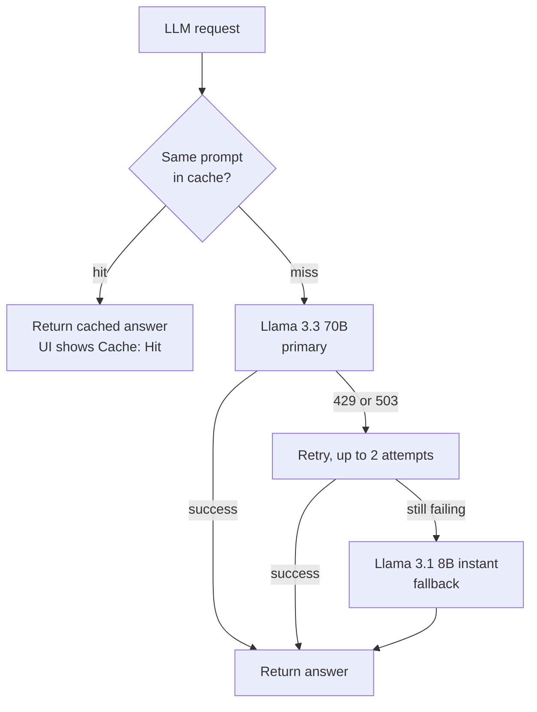

- **Fallback** keeps the app answering when the primary model is rate limited.
- **Simple cache** returns identical prompts instantly. The responder reads the `x-portkey-cache-status` header to show cache hits in the UI.
- LangChain nodes use `ChatOpenAI` pointed at the Portkey base URL, because Portkey exposes an OpenAI-compatible endpoint and `ChatGroq` cannot route through a proxy.

---

## 9. Conversation memory

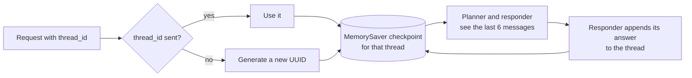

- The Streamlit UI creates one UUID per browser session and sends it with every message. "Clear memory" starts a new UUID.
- A request without a `thread_id` gets its own fresh thread. (Earlier, all such requests shared one `default_user` thread, so different clients could see each other's history.)
- Only the last 6 messages go into each prompt, so long chats do not grow the prompt without limit.
- `MemorySaver` lives in process memory. For several replicas or restarts, swap it for a Postgres or Redis checkpointer.

---

## 10. Evaluation

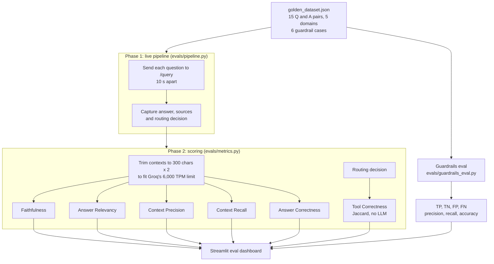

| Metric | Question it answers |
|--------|--------------------|
| Faithfulness | Is every claim in the answer supported by the retrieved context? |
| Answer Relevancy | Does the answer actually address the question? |
| Context Precision | Are the useful chunks ranked near the top? |
| Context Recall | Did retrieval find everything the reference answer needs? |
| Answer Correctness | How close is the answer to the reference, factually and semantically? |
| Tool Correctness | Did the planner pick the expected route (retrieve, answer directly or guardrails)? |

- The judge is `llama-3.1-8b-instant` on a separate key (`JUDGE_GROQ`), so evaluation never eats the live app's rate limit.
- Trimming each context to 300 characters and keeping 2 chunks cuts a Faithfulness request from about 7,700 to about 400 tokens (94.8% smaller). This is a budget workaround for the free tier: the judge sees less evidence, so Faithfulness and Context Recall are biased downward. Use full contexts when a larger token budget is available.
- The golden set is small (15 questions), so treat it as a regression check rather than a benchmark.

---

## 11. Observability

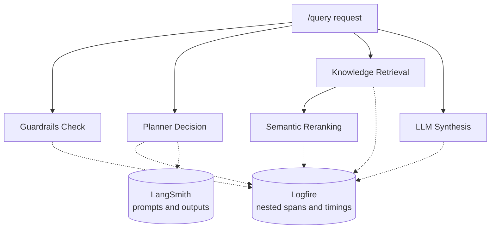

- Each node opens a Logfire span, so you can see which step is slow or failing for any request.
- `logfire.configure()` runs at the very top of `app/main.py`, before any app import. If any module logs before Logfire is configured, Logfire silently drops every later trace for that process. Heavy clients such as FlashRank and Gemini are loaded lazily for the same reason, and so that the API starts quickly.

---

## 12. Project structure

```text
8hr-MARATHON/
├── app/
│   ├── agents/
│   │   ├── graph.py         # LangGraph wiring and routing
│   │   ├── state.py         # Shared AgentState
│   │   └── nodes/           # planner.py, retriever.py, responder.py
│   ├── gateway/             # Portkey client: fallback, retry, cache
│   ├── guardrails/          # Colang rules and the guard() gate
│   ├── ingestion/
│   │   ├── chunking/        # Recursive splitter with overlap
│   │   ├── loaders/         # PDF, HTML, TXT, DOCX, PPTX parsers
│   │   └── processor.py     # Parse, chunk, embed, index
│   ├── services/retrieval/  # Embeddings, Qdrant search, FlashRank
│   ├── config.py            # Settings from environment variables
│   └── main.py              # FastAPI app and /query endpoint
├── evals/                   # RAGAS pipeline, guardrail eval, dashboard
├── tests/                   # Offline unit tests (no API keys needed)
├── ui/                      # Streamlit chat interface
├── notebooks/               # Guardrail, gateway and eval experiments
├── processed_data/          # Generated: chunked JSON per document
├── DATA/                    # true_data (6 docs) and noisy_data (58 files)
├── DOCS/                    # 11 in-depth guides
├── Dockerfile               # Production image for the API
├── requirements.txt         # Full local dependencies
└── requirements-prod.txt    # Pinned API-only dependencies
```

---

## 13. Getting started

### 1. Install dependencies

```powershell
python -m venv tenvv
.\tenvv\Scripts\activate
pip install -r requirements.txt
```

### 2. Configure the environment

Copy `.env.example` to `.env` and fill in the keys:

```env
GROQ_API_KEY = ""
GROQ_FALLBACK_API_KEY = ""          # second Groq key, or the same as primary
PORTKEY_API_KEY = ""
QDRANT_API_KEY = ""
QDRANT_CLUSTER_ENDPOINT = ""        # for example https://your-cluster.cloud.qdrant.io:6333
GEMINI_API_KEY = ""
LOGFIRE_TOKEN = ""
LANGSMITH_TRACING = true
LANGSMITH_ENDPOINT = https://api.smith.langchain.com
LANGSMITH_API_KEY = ""
LANGSMITH_PROJECT = ""
BACKEND_URL = ""                    # for example http://localhost:8000
JUDGE_GROQ = ""                     # separate key for the eval judge
```

### 3. Ingest the documents

```powershell
python -m app.ingestion.processor DATA --wipe
```

### 4. Start the backend and the UI

```powershell
# Terminal 1: FastAPI backend
uvicorn app.main:app --reload --port 8000

# Terminal 2: Streamlit UI
streamlit run ui/app.py
```

Open `http://localhost:8000/graph` to see a rendered image of the agent graph.

### 5. Run the evaluation dashboard (optional)

```powershell
# Needs the backend running on port 8000
streamlit run evals/app.py
```

### 6. Run the unit tests

```powershell
python -m pytest tests -q
```

The tests stub out tracing and the LLM gateway, so they run offline without any API keys.

---

## 14. Changelog

| Problem | Effect | Fix |
|---------|--------|-----|
| The chunker only split on blank lines, but PDF and HTML text mostly has single line breaks | Whole documents became one chunk (up to 62,725 chars). Embeddings and the reranker silently truncated them, and chunks over 25K chars were dropped from the prompt, leaving no context | Recursive splitter with a hard cap and 200-char overlap. Largest chunk is now 1,697 chars; 80 chunks became 189 |
| Pages recovered by pdfplumber were appended at the end of the document | Text out of order, broken chunks | Pages kept in reading order with a blank line between them |
| Routing compared the planner output with an exact `== "CONVERSATIONAL"` | Replies like `CONVERSATIONAL.` were sent to Qdrant as a search query | `is_conversational()` normalises the output first; covered by tests |
| The full conversation was sent to the LLM every turn | Prompts grew without limit and hit Groq rate limits | Planner and responder use the last 6 messages |
| The responder could answer beyond the retrieved text | Lower faithfulness and no traceability | Numbered context, required citations, explicit "not found" behaviour, and an instruction to ignore commands inside documents |
| Requests without a `thread_id` shared one `default_user` memory | Different clients could see each other's conversation | Each request without an ID gets a new UUID |

After pulling these changes, re-run ingestion with `--wipe` so Qdrant stores the new chunks.

---

## 15. Known limitations

These are documented on purpose, as the next things to improve:

- **Re-ingesting without `--wipe` duplicates chunks**, because point IDs are random UUIDs. Deterministic IDs (a hash of file name and chunk index) would make ingestion idempotent.
- **Embedding fallback can silently return nothing.** If Gemini is down at query time, the 768-dim fallback cannot search a 3072-dim collection, and retrieval returns an empty list.
- **Rail detection relies on matching reply text.** If a canned reply is reworded in one place but not the other, a fired rail is missed. Reading the activated flow from NeMo directly would be sturdier.
- **Memory is in-process**, so it is lost on restart and not shared across replicas.
- **The evaluation set is small** (15 questions, 6 guardrail cases) and uses truncated contexts, so scores are indicative rather than conclusive.
- **Dense-only retrieval** can miss exact tokens such as config keys or error codes. Hybrid search (BM25 or sparse vectors fused with dense results) would help.

---

## 16. Documentation index

| # | Guide | What it covers |
|---|-------|---------------|
| 01 | [System Overview](DOCS/01_SYSTEM_OVERVIEW.md) | High-level vision and end-to-end flow |
| 02 | [Ingestion Engine](DOCS/02_INGESTION_ENGINE.md) | Document parsing and indexing pipeline |
| 03 | [Node Intelligence](DOCS/03_NODE_INTELLIGENCE.md) | Planner, Retriever and Responder internals |
| 04 | [Observability](DOCS/04_TRACING_AND_OBSERVABILITY.md) | Logfire and LangSmith tracing |
| 05 | [Environment Variables](DOCS/05_ENVIRONMENT_VARIABLES.md) | Every environment variable and setting |
| 06 | [Known Gotchas](DOCS/06_KNOWN_GOTCHAS.md) | Non-obvious bugs and design decisions |
| 07 | [FlashRank Reranking](DOCS/07_FLASHRANK_RERANKING.md) | The local reranker in depth |
| 08 | [Guardrails](DOCS/08_GUARDRAILS.md) | NeMo Guardrails implementation |
| 09 | [LLM Gateway](DOCS/09_LLM_GATEWAY.md) | Portkey routing, fallback and caching |
| 10 | [Evals](DOCS/10_EVALS.md) | RAGAS metric theory and token budget |
| 11 | [Evals Pipeline](DOCS/11_EVALS_PIPELINE.md) | Live eval pipeline and Streamlit dashboard |
